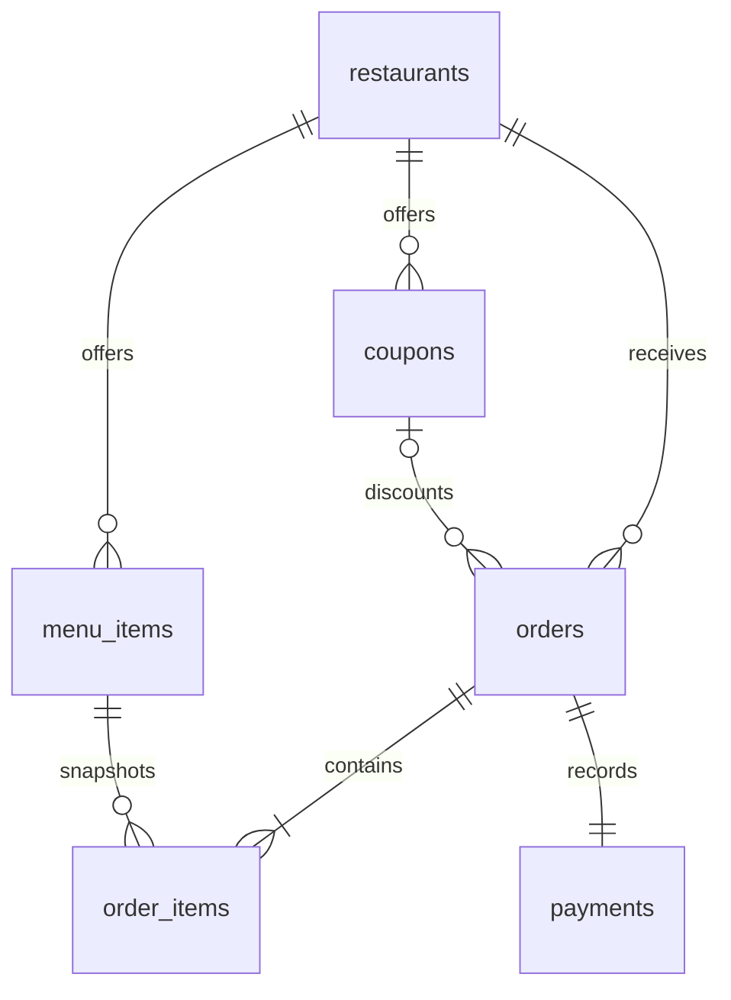

# Restaurant ordering practice

A small backend sandbox inspired by McDonald's, KFC, and Burger King. Names, menus, prices, and coupons are fictional practice data. Payments are simulated; this does not integrate with those companies or charge cards.

## Tables and relationships



| Table | Purpose |
| --- | --- |
| `restaurants` | Three restaurant records with active flags and currency |
| `menu_items` | Names, categories, prices, availability, and restaurant ownership |
| `coupons` | Restaurant-specific percentage discount, minimum spend, expiry, active flag |
| `orders` | Unique order number, restaurant, coupon, status, subtotal, discount, total |
| `order_items` | Quantities and snapshots of item names/prices at checkout |
| `payments` | Simulated result, amount, provider, card brand and last four digits |

The earlier `pw_bookings` exercise remains available separately.

## Installation

The migration has already been applied to the project's configured practice Supabase database. On a fresh project, configure `.env`, then run:

```sh
npm ci
npm run setup:restaurants
npm run demo:orders
npm run test:restaurants
```

Run `setup:restaurants` **once**. It creates six tables, a function, and menu/coupon seed rows in one transaction. It does not drop or overwrite existing tables. A second run deliberately fails on existing tables and rolls back. Alternatively, run the whole `supabase/restaurant-demo.sql` in Supabase's SQL Editor.

`demo:orders` uses the REST API to create three persistent sample orders. It checks fixed sample UUIDs before creation so rerunning it does not deliberately duplicate them. Avoid concurrent runs. Two samples are paid; one has a declined payment. Automated tests allocate random UUIDs and remove their own orders, including cascading item/payment cleanup. They leave sample orders intact.

## Swagger documentation

Run `npm run docs` and open http://127.0.0.1:3000 to browse and try the supported endpoints. See [docs/API.md](docs/API.md) for the endpoint index and walkthrough, or [docs/openapi.json](docs/openapi.json) for the portable OpenAPI specification.

## Basic API flow

Use the project URL plus these REST paths. Backend calls send the local `SUPABASE_SECRET_KEY` in the `apikey` header. Never expose that key in a browser/frontend. `lib/api.js` handles this for the tests.

| Action | Method and path |
| --- | --- |
| Browse restaurants | `GET /rest/v1/restaurants?active=eq.true&order=name` |
| Browse a menu | `GET /rest/v1/menu_items?restaurant_id=eq.<UUID>&available=eq.true&order=name` |
| Find active coupons | `GET /rest/v1/coupons?restaurant_id=eq.<UUID>&active=eq.true` (also check expiry/minimum; checkout enforces them) |
| Place an order | `POST /rest/v1/rpc/place_order` |
| Get receipt by order number | `GET /rest/v1/orders?order_number=eq.<NUMBER>&select=*,order_items(*),payments(*)` |
| List restaurant orders | `GET /rest/v1/orders?restaurant_id=eq.<UUID>&order=created_at.desc` |

Checkout body (use a new UUID for every order):

```json
{
  "p_order_id": "50000000-0000-4000-8000-000000000001",
  "p_restaurant_id": "10000000-0000-4000-8000-000000000001",
  "p_items": [
    { "menu_item_id": "20000000-0000-4000-8000-000000000001", "quantity": 2 },
    { "menu_item_id": "20000000-0000-4000-8000-000000000002", "quantity": 1 }
  ],
  "p_coupon_code": "SAVE10",
  "p_test_card": "test_card_approved"
}
```

This buys two $5.99 burgers and $2.49 fries: subtotal 1447 cents, discount 144 cents, total 1303 cents. The response includes the order UUID, automatically assigned `order_number`, status `paid`, currency `USD`, and amounts. Successful RPC calls return HTTP 200. The database independently calculates prices from the menu; clients do not submit authoritative totals.

Amounts are integer USD cents. Discounts round down to a whole cent. Order numbers are unique across all restaurants and can have gaps after rollbacks or deleted test orders. Receipt filters return an array, empty when no order matches.

### Coupon rules

| Restaurant | Code | Discount | Minimum subtotal |
| --- | --- | --- | --- |
| McDonald's Demo | `SAVE10` | 10% | $10.00 |
| KFC Demo | `CHICKEN15` | 15% | $10.00 |
| Burger King Demo | `KING10` | 10% | $10.00 |

One coupon per order. Codes are trimmed and matched case-insensitively. Coupons are reusable; there are no per-customer limits. Seeds also include `EXPIRED` and `DISABLED` for negative tests. Invalid coupons reject the whole request; they do not silently remove the discount.

### Payment rules

- `test_card_approved`: `orders.status = paid`, `payments.status = approved`.
- `test_card_declined`: `orders.status = payment_failed`, `payments.status = declined`.
- Other tokens are rejected before writing records.

No full card number, CVV, expiry date, or real payment credential is accepted or stored. Card metadata is a fixed fictional Visa ending in 4242, not derived from user input. A declined card still produces an order number and a recorded failed payment; HTTP 200 means checkout was processed, not that payment succeeded.

Checkout atomically writes the order, item snapshots, and one payment. Invalid carts/coupons produce HTTP 400 and no partial records. Quantities must be integers from 1 to 20. A cart has at most 20 distinct menu items, all available and from the same restaurant. Menu names and prices are copied to the order items so later menu edits do not change old receipt line items. Coupon details themselves are not versioned; the order stores its applied discount amount.

## Explore the database

In Supabase's Table Editor, inspect `restaurants`, `menu_items`, `coupons`, `orders`, `order_items`, and `payments`. There are ten menu entries, including one unavailable item, five coupons, and three persistent sample orders.

SQL Editor example:

```sql
select o.order_number, r.name as restaurant, o.status,
       o.subtotal_cents, o.discount_cents, o.total_cents,
       p.status as payment_status, p.provider
from public.orders o
join public.restaurants r on r.id = o.restaurant_id
join public.payments p on p.order_id = o.id
order by o.order_number;
```

## Tests

```sh
npm run test:restaurants  # 22 restaurant tests
npm test                 # 28 total, including the 6 booking tests
npm run report
```

Restaurant coverage includes menus/prices against SQL, checkout/receipts, each restaurant's coupon, approved/declined cards, tampered prices, coupon expiry/activation/ownership/minimum, unavailable and cross-restaurant items, invalid quantities, empty carts, duplicate items, and unsupported payment tokens. Rejected requests are checked against all three transactional tables to confirm no partial writes.

The SQL test client is read-only by default. The one-time migration script explicitly enables writes. All mutations during tests use the REST API. Secret headers are omitted from traces/errors, and credentials remain ignored by Git.

## Scope

This is a backend testing exercise with an elevated service-role key. RLS is enabled, anonymous/authenticated privileges are revoked, and checkout execution is granted only to `service_role`. Do not use this key in a customer app. Direct administrative table writes can bypass checkout business rules; place normal orders using `place_order`.

To keep it small, there are no customer accounts, deliveries, stock management, taxes, refunds, real payment gateway, payment retries, or order-preparation workflow. Every checkout UUID is single-use; submitting the same UUID twice gets a conflict rather than creating another order. A real customer application would need user ownership policies and payment-provider integration.
